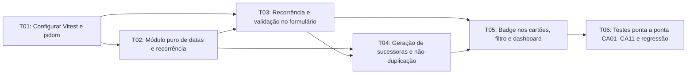

# Plano Técnico de Implementação: Tarefas Recorrentes no ToDo List Frontend

## 1. Contexto e Referências

- **Repositório Local:** `/home/nelson/IdeaProjects/todo-list`
- **Repositório Remoto:** `https://github.com/nelsonlima1989/todo-list-java`
- **Issue Relacionada:** [`#1 — [FEATURE] Implementar tarefas recorrentes no ToDo List Frontend`](https://github.com/nelsonlima1989/todo-list-java/issues/1)
- **Branch de Trabalho:** `feature/tarefas-recorrentes`
- **Especificação Base:** `docs/spec.md` (commit `1274295`)
- **Diretrizes do Agente:** `AGENTS.md` (commit `7929835`)

---

## 2. Diretrizes Arquiteturais e Regras de Execução SDD

1. **Escopo estrito no diretório `frontend/`:** Nenhuma alteração será realizada no backend Java (`src/`, `build.gradle`, `gradle/`, `settings.gradle`).
2. **Tecnologia:** Manter HTML5, CSS3 e JavaScript Vanilla (sem frameworks de UI).
3. **Desacoplamento entre Domínio e DOM via ES Modules nativos (sem bundler):** A lógica pura de cálculo de datas, preservação de `diaBaseRecorrencia`, elegibilidade e geração de sucessoras será isolada em `frontend/js/recorrencia.js` utilizando **ES Modules nativos** (`export` / `import`), sem qualquer bundler. Os `import`/`export` serão compatibilizados tanto com o carregamento nativo em `frontend/index.html` (``) quanto com a execução direta pelo **Vitest** (`"type": "module"` em `frontend/package.json`).
4. **Execução Incremental:**
   - Implementar **uma única tarefa por vez** (`T01` a `T06`).
   - Ao final de cada tarefa: inspecionar `git diff`, executar os testes automatizados (`Vitest` + `jsdom`) e realizar a validação prevista.
   - Criar **1 commit atômico por tarefa de implementação aprovada** (totalizando **6 commits de implementação**).
   - Caso surja necessidade de alterar qualquer regra de negócio, atualizar `docs/spec.md` mediante aprovação **antes** de modificar o código.
5. **Regras Gerais de Validação e Entrega por Tarefa:**
   Ao concluir a implementação de cada tarefa (`T01` a `T06`) e antes de solicitar autorização para o commit, o agente deverá apresentar obrigatoriamente:
   - **Arquivos alterados.**
   - **Resumo do diff.**
   - **Comandos de teste executados.**
   - **Quantidade de testes aprovados e reprovados.**
   - **Problemas encontrados e correções aplicadas.**
   - **Evidência da validação manual, quando aplicável.**
   - **Sugestão de mensagem de commit.**
6. **Registro de Consumo de Tokens/Créditos para o Relatório Final (`RELATORIO.md`):**
   - O consumo aproximado de tokens ou créditos por etapa do desenvolvimento SDD deverá ser registrado posteriormente no `RELATORIO.md`, utilizando as métricas disponíveis na ferramenta/ambiente ou estimativas explicitamente identificadas como tal.

---

## 3. Detalhamento das Tarefas (`T01` a `T06`)

### T01 — Configurar Vitest e jsdom no frontend
- **Status:** `[ ] Pendente`
- **Objetivo:** Configurar a infraestrutura de testes automatizados com **Vitest** e **jsdom** exclusivamente dentro do diretório `frontend/`, sem impactar a raiz ou o projeto Gradle/Java.
- **Descrição das alterações:**
  - Criar `frontend/package.json` com `"private": true`, scripts `"test": "vitest run"` e `"test:watch": "vitest"`, e `devDependencies` contendo `vitest` e `jsdom`.
  - Criar `frontend/vitest.config.js` definindo `environment: "jsdom"`.
  - Criar `frontend/.gitignore` ignorando `node_modules/`.
  - Criar `frontend/tests/setup.test.js` com teste inicial validando a disponibilidade de `document`, `window` e `localStorage` no ambiente `jsdom`.
- **Arquivos criados ou modificados:**
  - `frontend/package.json` (novo)
  - `frontend/package-lock.json` (novo)
  - `frontend/vitest.config.js` (novo)
  - `frontend/.gitignore` (novo)
  - `frontend/tests/setup.test.js` (novo)
- **Requisitos funcionais atendidos:** Infraestrutura base de verificação para `RF01` a `RF08`.
- **Critérios de aceite relacionados:** Base de execução automatizada para `CA01` a `CA11`.
- **Dependências:** Nenhuma.
- **Testes automatizados a executar:**
  - `cd frontend && npm test` (`frontend/tests/setup.test.js`).
- **Validação manual necessária:**
  - Confirmar que `git status` não lista `frontend/node_modules/` e que `frontend/index.html` permanece íntegro.
- **Critério objetivo de conclusão:**
  - Comando `npm test` em `frontend/` finalizando com código `0` e `setup.test.js` passando.
- **Mensagem de commit sugerida:**
  - `chore(frontend): configura Vitest e jsdom para testes automatizados (#1)`

---

### T02 — Implementar módulo puro de cálculo de datas e regras de recorrência
- **Status:** `[ ] Pendente`
- **Objetivo:** Implementar em `frontend/js/recorrencia.js` todas as funções puras de cálculo de datas, avanço para data estritamente futura, preservação de `diaBaseRecorrencia` em meses curtos/bissextos, verificação de elegibilidade (`sucessoraGerada`) e normalização de tarefas antigas do `localStorage`, de forma independente do DOM e utilizando ES Modules nativos.
- **Descrição das alterações:**
  - Criar `frontend/js/recorrencia.js` utilizando **ES Modules nativos** (`export const ...`, sem bundler), garantindo compatibilidade direta tanto com o `import` nativo do navegador via `frontend/js/script.js` quanto com os testes no **Vitest**, contendo:
    - `RECORRENCIAS_VALIDAS`: `["NENHUMA", "DIARIA", "SEMANAL", "MENSAL"]`.
    - `normalizarTarefa(tarefa)`: garante `recorrencia` válida (padrão `"NENHUMA"`), `sucessoraGerada` booleana (padrão `false`) e `diaBaseRecorrencia` numérico (`1`–`31` quando `"MENSAL"`, inferido de `dataTermino` se ausente, ou `null` para demais recorrências).
    - `obterUltimoDiaDoMes(ano, mes)`: retorna o último dia do mês (`28`, `29`, `30` ou `31`), tratando corretamente anos bissextos.
    - `calcularProximaDataTermino(dataTerminoAtual, recorrencia, diaBaseRecorrencia, dataReferenciaHoje)`: avança no mínimo 1 ciclo (`+1 dia`, `+7 dias` ou `+1 mês` com $\min(\text{diaBaseRecorrencia}, \text{ultimoDiaDoMes})$) e continua avançando ciclos sucessivos enquanto `novaData <= dataReferenciaHoje`.
    - `deveGerarSucessora(tarefa)`: retorna `true` somente se `recorrencia !== "NENHUMA"`, `status === "DONE"`, `sucessoraGerada === false` e `dataTermino` preenchida.
    - `gerarTarefaSucessora(tarefaConcluida, novoId, dataReferenciaHoje)`: constrói o objeto da nova tarefa com `id: novoId`, `status: "TODO"`, `sucessoraGerada: false`, `diaBaseRecorrencia` preservado e nova `dataTermino` calculada.
  - Criar `frontend/tests/recorrencia.test.js` cobrindo unitariamente todas as funções e casos de borda.
- **Arquivos criados ou modificados:**
  - `frontend/js/recorrencia.js` (novo)
  - `frontend/tests/recorrencia.test.js` (novo)
- **Requisitos funcionais atendidos:** `RF03` (regras de elegibilidade e criação do objeto sucessor), `RF04`, `RF05`, `RF06` (verificação de `sucessoraGerada`) e Retrocompatibilidade (`localStorage`).
- **Critérios de aceite relacionados:** `CA01` (parcial — defaults do modelo), `CA03`, `CA04`, `CA05`, `CA06`, `CA11` (normalização de objetos legados).
- **Dependências:** `T01`.
- **Testes automatizados a executar:**
  - `cd frontend && npm test` (`frontend/tests/recorrencia.test.js`).
- **Validação manual necessária:**
  - Conferir nos logs do Vitest a execução dos cenários de série mensal (`2026-01-31 → 2026-02-28 → 2026-03-31 → 2026-04-30`), ano bissexto (`2028-01-31 → 2028-02-29 → 2028-03-31`) e tarefa atrasada avançando múltiplos ciclos até `> hoje`.
- **Critério objetivo de conclusão:**
  - Todas as funções exportadas e 100% dos testes unitários em `frontend/tests/recorrencia.test.js` passando.
- **Mensagem de commit sugerida:**
  - `feat(frontend): implementa calculo de datas e regras puras de recorrencia (#1)`

---

### T03 — Integrar campo de recorrência e validação de data de término ao formulário
- **Status:** `[ ] Pendente`
- **Objetivo:** Adicionar o campo `<select id="recorrencia" name="recorrencia">` ao formulário em `frontend/index.html`, ajustar o grid responsivo em `frontend/css/style.css` e integrar em `frontend/js/script.js` (via ES Modules nativos) a leitura, edição, limpeza, normalização inicial do `localStorage` e obrigatoriedade de `#data-termino` para tarefas recorrentes.
- **Descrição das alterações:**
  - Em `frontend/index.html`:
    - Adicionar `
` com `<label for="recorrencia">Recorrência</label>` e `<select id="recorrencia" name="recorrencia">` (`NENHUMA`, `DIARIA`, `SEMANAL`, `MENSAL`) dentro de `.form-row`.
    - Atualizar a tag de script para ``, permitindo que `script.js` importe `./recorrencia.js` usando ES Modules nativos no navegador e no Vitest, sem necessidade de bundler.
  - Em `frontend/css/style.css`:
    - Atualizar `.form-row` para `grid-template-columns: repeat(5, 1fr)` no desktop, mantendo `repeat(2, 1fr)` em `@media (max-width: 900px)` e `1fr` em `@media (max-width: 600px)`.
  - Em `frontend/js/script.js`:
    - Importar as funções de `./recorrencia.js` via ES Modules (`import { ... } from "./recorrencia.js"`).
    - Normalizar os itens carregados de `localStorage.getItem("tarefas")` com `normalizarTarefa`.
    - Referenciar `campoRecorrencia` (`#recorrencia`) e `campoDataTermino` (`#data-termino`).
    - Atualizar dinamicamente `campoDataTermino.required = campoRecorrencia.value !== "NENHUMA"` no evento `change` de `#recorrencia` e no `reset` do formulário.
    - No `submit` do formulário: impedir o salvamento (exibindo alerta/validação e abortando) se `recorrencia !== "NENHUMA"` e `!dataTermino`.
    - Na criação/edição: persistir `recorrencia`, `diaBaseRecorrencia` (definido/atualizado conforme `RF05`) e `sucessoraGerada`.
    - No botão `.btn-edit`: preencher `#recorrencia` com `tarefa.recorrencia || "NENHUMA"` e sincronizar obrigatoriedade de `#data-termino`.
  - Criar `frontend/tests/formulario-recorrencia.test.js` testando o comportamento do formulário via DOM (`jsdom`).
- **Arquivos criados ou modificados:**
  - `frontend/index.html` (modificado)
  - `frontend/css/style.css` (modificado)
  - `frontend/js/script.js` (modificado)
  - `frontend/tests/formulario-recorrencia.test.js` (novo)
- **Requisitos funcionais atendidos:** `RF01`, `RF02`, `RF05` (atribuição/preservação de `diaBaseRecorrencia` no formulário).
- **Critérios de aceite relacionados:** `CA01`, `CA02`, `CA11`.
- **Dependências:** `T01`, `T02`.
- **Testes automatizados a executar:**
  - `cd frontend && npm test` (`frontend/tests/formulario-recorrencia.test.js` e suítes anteriores).
- **Validação manual necessária:**
  - Abrir `http://localhost:8080`, verificar o campo `Recorrência` com valor padrão `Nenhuma`, selecionar `Diária`/`Semanal`/`Mensal` sem data de término e confirmar o bloqueio de envio.
- **Critério objetivo de conclusão:**
  - Campo `#recorrencia` integrado ao HTML/CSS/JS, validação de `#data-termino` obrigatória para tarefas recorrentes funcionando e todos os testes em `frontend/tests/formulario-recorrencia.test.js` passando.
- **Mensagem de commit sugerida:**
  - `feat(frontend): adiciona campo de recorrencia e validacao de data no formulario (#1)`

---

### T04 — Implementar geração de sucessoras e prevenção de duplicações
- **Status:** `[ ] Pendente`
- **Objetivo:** Conectar a geração automática de tarefas sucessoras (`status: "TODO"`) ao concluir uma tarefa recorrente (`DONE`) por criação direta, edição no formulário ou alteração de status em massa, garantindo a marcação `sucessoraGerada: true`, a não-duplicação após reabertura e o isolamento na edição/exclusão.
- **Descrição das alterações:**
  - Em `frontend/js/script.js`:
    - Na criação de tarefa (`editandoPorId === null`): se `deveGerarSucessora(novaTarefa)` for verdadeiro (tarefa recorrente criada diretamente com `status: "DONE"`), definir `novaTarefa.sucessoraGerada = true`, criar imediatamente a tarefa sucessora com `gerarTarefaSucessora(novaTarefa, proximoId++)` e adicioná-la ao array `tarefas`.
    - Na edição de tarefa (`editandoPorId !== null`):
      - Atualizar apenas os campos do registro `tarefaExistente`, preservando `tarefaExistente.sucessoraGerada` (jamais revertendo `true` para `false`).
      - Se após atualizar o registro `deveGerarSucessora(tarefaExistente)` for verdadeiro, marcar `tarefaExistente.sucessoraGerada = true` e inserir a nova ocorrência com `gerarTarefaSucessora(tarefaExistente, proximoId++)`.
    - Na alteração de status em massa (`botaoStatusMultiplo`):
      - Ao atualizar `tarefa.status = novoStatus`, caso `deveGerarSucessora(tarefa)` seja verdadeiro, marcar `tarefa.sucessoraGerada = true` e adicionar a sucessora gerada ao array `tarefas`.
  - Criar `frontend/tests/geracao-sucessora.test.js` validando todos os fluxos de conclusão e não-duplicação no DOM.
- **Arquivos criados ou modificados:**
  - `frontend/js/script.js` (modificado)
  - `frontend/tests/geracao-sucessora.test.js` (novo)
- **Requisitos funcionais atendidos:** `RF03`, `RF04`, `RF05`, `RF06`, `RF07`.
- **Critérios de aceite relacionados:** `CA03`, `CA04`, `CA05`, `CA06`, `CA07`, `CA08`, `CA09`.
- **Dependências:** `T02`, `T03`.
- **Testes automatizados a executar:**
  - `cd frontend && npm test` (`frontend/tests/geracao-sucessora.test.js` e suítes anteriores).
- **Validação manual necessária:**
  - No navegador (`http://localhost:8080`), testar:
    1. Criar tarefa recorrente diretamente como `DONE` e verificar criação imediata da sucessora `TODO`.
    2. Concluir tarefa recorrente via edição e via ação em massa.
    3. Reabrir tarefa concluída (`DONE → TODO`) e concluí-la novamente (`DONE`), confirmando que nenhuma duplicata é gerada.
    4. Editar e excluir ocorrências individualmente, verificando isolamento.
- **Critério objetivo de conclusão:**
  - Sucessoras geradas corretamente nos 3 pontos de entrada, `sucessoraGerada` protegido contra duplicação e 100% dos testes em `frontend/tests/geracao-sucessora.test.js` passando.
- **Mensagem de commit sugerida:**
  - `feat(frontend): implementa geracao de sucessoras e prevencao de duplicacoes (#1)`

---

### T05 — Integrar recorrência aos cartões, filtros e dashboard
- **Status:** `[ ] Pendente`
- **Objetivo:** Exibir a identificação visual de recorrência (`.task-recurrence`) nos cartões de tarefas recorrentes, mantendo os cartões de tarefas avulsas sem badge e assegurando o funcionamento integrado do filtro por status e dos contadores do dashboard.
- **Descrição das alterações:**
  - Em `frontend/js/script.js`:
    - Mapear os rótulos de exibição (`DIARIA: "Diária"`, `SEMANAL: "Semanal"`, `MENSAL: "Mensal"`).
    - Em `renderizarTarefas()`, renderizar condicionalmente `🔁 Recorrência: ${rotuloRecorrencia}` dentro de `.task-information` (ou `.task-header`) apenas quando `tarefa.recorrencia && tarefa.recorrencia !== "NENHUMA"`.
  - Em `frontend/css/style.css`:
    - Adicionar estilização para `.task-recurrence` alinhada ao tema *dark glassmorphism* (cor de destaque suave, espaçamento e legibilidade em desktop e mobile).
  - Criar `frontend/tests/cartoes-filtro-dashboard.test.js` verificando a renderização condicional do badge, a atualização dos contadores (`#total-tarefas`, `#tarefas-todo`, `#tarefas-doing`, `#tarefas-done`) e a filtragem por `#filtro-status`.
- **Arquivos criados ou modificados:**
  - `frontend/js/script.js` (modificado)
  - `frontend/css/style.css` (modificado)
  - `frontend/tests/cartoes-filtro-dashboard.test.js` (novo)
- **Requisitos funcionais atendidos:** `RF08`.
- **Critérios de aceite relacionados:** `CA01` (ausência de badge em tarefa sem recorrência), `CA10`.
- **Dependências:** `T03`, `T04`.
- **Testes automatizados a executar:**
  - `cd frontend && npm test` (`frontend/tests/cartoes-filtro-dashboard.test.js` e suítes anteriores).
- **Validação manual necessária:**
  - Verificar em `http://localhost:8080` a exibição do badge nos cartões `Diária`, `Semanal` e `Mensal`, a ausência em tarefas `Nenhuma`, e a filtragem `TODOS`, `TODO`, `DOING` e `DONE`.
- **Critério objetivo de conclusão:**
  - Indicador `.task-recurrence` visível apenas nas tarefas recorrentes, estatísticas e filtro por status atualizados dinamicamente e todos os testes passando.
- **Mensagem de commit sugerida:**
  - `feat(frontend): exibe indicador de recorrencia nos cartoes de tarefa (#1)`

---

### T06 — Completar suíte de testes de critérios de aceite (CA01 a CA11) e validar regressões
- **Status:** `[ ] Pendente`
- **Objetivo:** Priorizar os testes de regressão das funcionalidades pré-existentes do ToDo List e complementar a validação integrada de quaisquer critérios de aceite (`CA01` a `CA11`) ainda não cobertos integralmente, evitando duplicar desnecessariamente os testes unitários e de integração já criados nas tarefas `T02` a `T05`.
- **Descrição das alterações:**
  - Criar `frontend/tests/regressao-e-aceite.test.js` priorizando:
    - **Testes de regressão das funcionalidades existentes:** CRUD de tarefas avulsas, bloqueio de exclusão durante modo de edição (`editandoPorId === id`), renderização de `.empty-state`, alteração de status em massa de múltiplas tarefas e persistência/recarregamento completo de tarefas legadas no `localStorage` (`CA11`).
    - **Complementação de critérios de aceite (`CA01` a `CA11`):** cobrir fluxos integrados ponta a ponta ainda não exercitados em conjunto nas tarefas anteriores, sem repetir testes unitários puros já presentes em `recorrencia.test.js`.
- **Arquivos criados ou modificados:**
  - `frontend/tests/regressao-e-aceite.test.js` (novo)
- **Requisitos funcionais atendidos:** Validação completa de `RF01` a `RF08` e Retrocompatibilidade.
- **Critérios de aceite relacionados:** `CA01`, `CA02`, `CA03`, `CA04`, `CA05`, `CA06`, `CA07`, `CA08`, `CA09`, `CA10`, `CA11`.
- **Dependências:** `T01`, `T02`, `T03`, `T04`, `T05`.
- **Testes automatizados a executar:**
  - Execução completa de `cd frontend && npm test` passando todas as 6 suítes de teste.
- **Validação manual necessária:**
  - Executar checklist final no navegador (`http://localhost:8080`) e inspecionar `git status` e `git diff main...feature/tarefas-recorrentes` confirmando que nenhum arquivo do backend Java foi tocado.
- **Critério objetivo de conclusão:**
  - 100% das suítes de teste no Vitest passando com cobertura integral de `CA01` a `CA11` e zero regressões.
- **Mensagem de commit sugerida:**
  - `test(frontend): adiciona testes ponta a ponta de criterios de aceite e regressao (#1)`

---

## 4. Grafo de Dependências entre as Tarefas

---

## 5. Matriz de Rastreabilidade (Requisitos, Critérios de Aceite e Tarefas)

| Critério de Aceite | Descrição Resumida | Requisitos | Tarefas |
| :--- | :--- | :--- | :--- |
| **CA01** | Padrão `"NENHUMA"`, sem badge e sem sucessora ao concluir | `RF01`, `RF03`, `RF08` | `T02`, `T03`, `T05`, `T06` |
| **CA02** | Obrigatoriedade de `dataTermino` quando `recorrencia !== "NENHUMA"` | `RF02` | `T03`, `T06` |
| **CA03** | Recorrência Diária (`+1d`) e Semanal (`+7d`) em tarefa futura | `RF03`, `RF04` | `T02`, `T04`, `T06` |
| **CA04** | Avanço de múltiplos ciclos até data estritamente futura (`> hoje`) | `RF04` | `T02`, `T04`, `T06` |
| **CA05** | Recorrência Mensal em meses curtos preservando `diaBaseRecorrencia` (`31/01 → 28/02 → 31/03`) | `RF03`, `RF05` | `T02`, `T04`, `T06` |
| **CA06** | Recorrência Mensal em ano bissexto (`2028-01-31 → 2028-02-29 → 2028-03-31`) | `RF03`, `RF05` | `T02`, `T04`, `T06` |
| **CA07** | Criação direta com status `DONE` (data simulada `2026-11-04`, `10/11 → 11/11`) | `RF03`, `RF04`, `RF06` | `T04`, `T06` |
| **CA08** | Prevenção de duplicação (`sucessoraGerada: true`) após edição ou reabertura | `RF06` | `T02`, `T04`, `T06` |
| **CA09** | Isolamento na edição e exclusão de ocorrências | `RF07` | `T04`, `T06` |
| **CA10** | Indicador `.task-recurrence` nos cartões, contadores do dashboard e filtro por status | `RF08` | `T05`, `T06` |
| **CA11** | Compatibilidade com tarefas antigas armazenadas no `localStorage` | Seção 3 (Spec) | `T02`, `T03`, `T06` |

---

## 6. Previsão de Commits de Implementação

Cada tarefa de implementação (`T01` a `T06`), após concluída, revisada via `git diff`, validada pelos testes automatizados e aprovada pelo usuário, gerará **1 commit próprio** (total de **6 commits de implementação**, além do commit documental deste `docs/plano.md` quando autorizado):

1. `chore(frontend): configura Vitest e jsdom para testes automatizados (#1)` (`T01`)
2. `feat(frontend): implementa calculo de datas e regras puras de recorrencia (#1)` (`T02`)
3. `feat(frontend): adiciona campo de recorrencia e validacao de data no formulario (#1)` (`T03`)
4. `feat(frontend): implementa geracao de sucessoras e prevencao de duplicacoes (#1)` (`T04`)
5. `feat(frontend): exibe indicador de recorrencia nos cartoes de tarefa (#1)` (`T05`)
6. `test(frontend): adiciona testes ponta a ponta de criterios de aceite e regressao (#1)` (`T06`)

